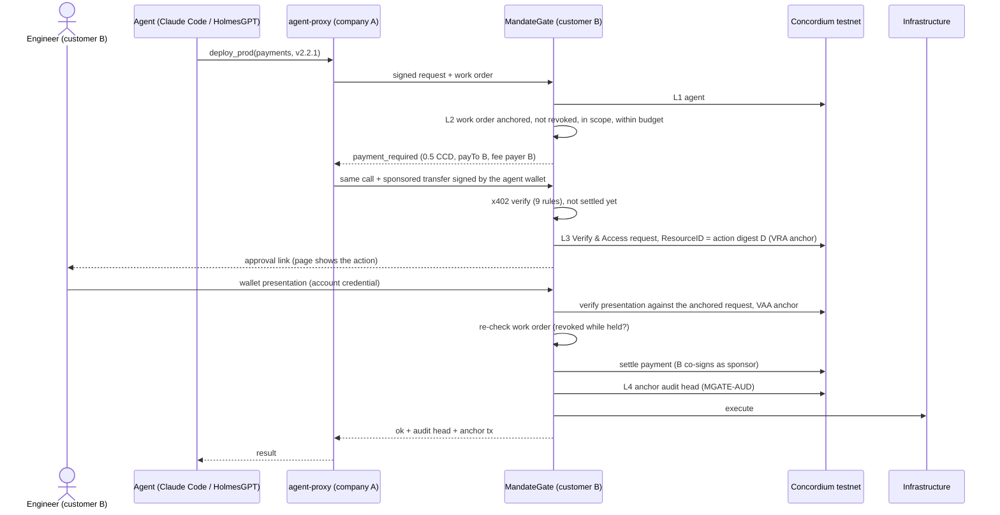

# Architecture

MandateGate sits between a provider's AI agent (company A) and a customer's infrastructure (customer B).
The agent is not modified: it calls ordinary MCP tools. Every call is signed on A's side and checked on
B's side against Concordium before anything runs.

## Components

| Component | Package | Runs at | Responsibility |
|---|---|---|---|
| Agent | any MCP client: Claude Code today (`demo/claude-agent`), HolmesGPT next | Company A | Investigates and decides; sees only the six tools, never a key |
| agent-proxy | `packages/agent-proxy` | Company A | Stdio MCP server for the agent. Holds the agent's EVM key (bound to agent #1505 with CIS-8) and signs every call; carries the work order; pays x402 requirements from the agent wallet within budget |
| Issuer CLI | `packages/issuer` | Company A | Builds, anchors and revokes work orders (`MGATE-WO` / `MGATE-WOREV`) |
| MandateGate gateway | `packages/gateway` | Customer B | Streamable-HTTP MCP server and decision pipeline (L1–L4 + x402), approval pages, x402 facilitator, audit log and anchors |
| Customer infrastructure | `infra/kind` + `packages/k8s-ops` (`packages/mock-ops` in tests) | Customer B | A real Kubernetes cluster (kind) with payments, billing and customer-db; the ops API behind the gateway drives it with kubectl |
| Customer dashboard | `packages/gateway/src/dashboard.ts` | Customer B | Live view of every agent call through the checks, budget, pending approvals, and a kill switch that stops a work order at once and anchors the stop |
| Shared core | `packages/core` | both | Request envelope (EIP-191), JCS hashing, CBOR anchors, work-order schema, approval digest, audit log, chain helpers |
| Concordium testnet | | | Agent Registry (CIS-8004), CIS-8 key registry, Register Data anchors, Verify & Access V1, sponsored transactions |

Tools and risk levels: level 0 `logs_read`, `service_status`; level 1 `service_restart`, `service_scale`;
level 2 `deploy_prod`, `data_delete`.

## Main flow (level-2 action)

Level-0 and level-1 actions run the same L1/L2 checks and are executed at once; they are covered by
the next audit anchor (before the next level-2 action, every 5 minutes, and at shutdown).

## Pipeline order and why

| Step | Check | Fails closed with |
|---|---|---|
| 1 | Envelope: EIP-191 signature, audience, 60 s window, params hash, action/resource binding | `bad_signature`, `expired`, `params_mismatch`, … |
| 2 | L1 agent on chain (registry, active, card URL and bytes, owner, CIS-8 key owner = agent owner, onboarded owner); fresh for level 2 | `agent_*` |
| 3 | L2 work order: hash matches, anchored by a trusted issuer, not revoked, chain view fresh (≤ 60 s), audience, agent, key, action, resource, time | `work_order_*`, `revocation_status_stale` |
| 4 | Idempotency (request id reserved once) and per-order rate limit | `replayed_request`, `rate_limited` |
| 5 | x402: budget left, payment verified, not reused | `payment_required`, `budget_exceeded`, `payment_invalid`, `payment_replayed` |
| 6 | L3 approval: VRA with ResourceID = D, presentation verified against chain, account credential, approver commitment if the order names one, 5-minute hold, single use | `approval_timeout`, `rejected_by_approver`, `presentation_invalid`, `approver_not_named_in_work_order` |
| 7 | Work order re-checked after the hold | `work_order_revoked` |
| 8 | Payment settled (only now: a rejected action costs nothing) | `payment_settle_failed` |
| 9 | Allow decision written, then anchored (level 2) | `audit_anchor_failed` |
| 10 | Execute, record the outcome | |

## Trust model

**On chain (Concordium testnet):** agent identity and its Agent Card hash (CIS-8004), the binding of
the signing key to the agent owner (CIS-8), each work order and revocation (Register Data, CBOR
`{hash, type, version}`), each approval request and its verification (VRA/VAA from Verify & Access V1),
each payment (sponsored CCD transfer), and the audit head (`MGATE-AUD {hash, seq}`).

**Off chain, and why:** work-order contents (the hash is enough to bind them; scopes and resources
are business data), the audit records (may contain operational details; the hash chain plus anchors
make them tamper evident), and the engineer's identity (the proof reveals only an account credential
id and the issuer; a work order can commit to the approver with a salted hash instead of naming them).

**Threats covered, with tests** (`packages/gateway/test/*.ts`, 49 tests in total with `packages/core`):

| Threat | Defence |
|---|---|
| Another key claims to be agent #1505 | CIS-8 owner of the key must equal the agent owner; pinned-key mode in tests |
| Replayed or altered request | Signed envelope with short validity, request-id ledger, params hash |
| Agent acts outside its mandate | Work-order scope per action and resource, expiry, rate limit |
| Mandate withdrawn | Revocation anchor followed block by block; about 15 s after finality in live tests |
| Customer wants it stopped now | Kill switch on the dashboard: work order suspended at the gateway immediately, recorded and anchored |
| Gateway cannot see the chain | Chain view older than 60 s → every request denied |
| Approval reused for another action | ResourceID = digest of audience, agent, work order, request, action, resource, params, nonce, expiry; bound into the VRA anchor (spike S3a) |
| Wrong person approves | Optional salted commitment to the approver's account credential in the work order |
| Nobody answers | 5-minute hold, then denied; held approvals are closed on restart |
| Over-spending | Budget per work order (gateway and proxy), payment replay refused, settle after approval |
| Records edited afterwards | Hash-chained audit log, head anchored before every level-2 action; `verify-audit` checks it against chain |
| Oversized or malformed input | Body size limit before parsing |

**Known limits** (see [path-to-production.md](path-to-production.md)): the wallet does not display the
request context, so the approval page shows the action; keys are files, not an HSM; one gateway
instance with JSON-lines storage; customer infrastructure is simulated.
