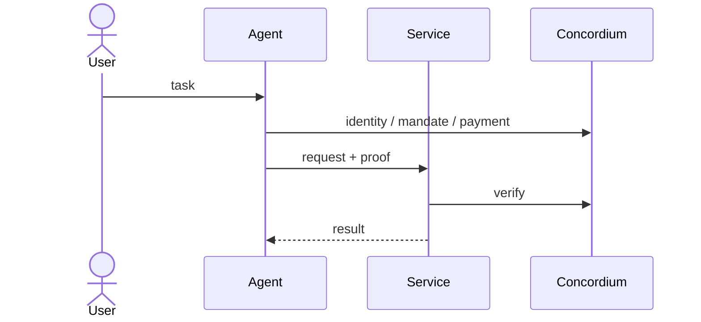

# Architecture

## Components

| Component | Tech | Responsibility |
|---|---|---|
| Agent | | |
| Backend / verifier | | |
| Frontend | | |
| Concordium | testnet | |

## Main flow

## Trust model
- What is verified on-chain:
- What stays off-chain (and why):
- Threats considered (spoofed agent, replayed proof, over-spending, tampered consent…):
